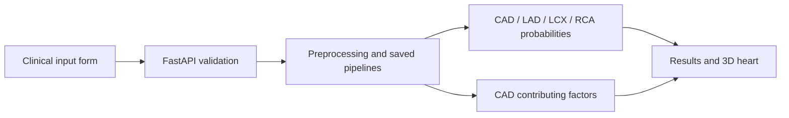

# Vascularis

### Clinical inputs. Clear insights. An interactive heart.

Vascularis is an educational cardiovascular AI application that turns clinical measurements into CAD and coronary-vessel risk estimates. A guided patient form, interactive 3D heart, and doctor-style assistant make the results easier to explore.

> **Research prototype — not a medical device.** Predictions are not diagnoses, treatment recommendations, or a substitute for clinical assessment. The models have not been externally validated.

## What you can do

- Enter clinical, laboratory, ECG, and echocardiographic measurements.
- Receive API-backed predictions for CAD, LAD, LCX, and RCA.
- Rotate and zoom a 3D heart with selectable vessel probability markers.
- Explore contributing factors for the CAD prediction and see which inputs were imputed.
- Follow the interactive guide and review validation information.

## Run locally

### Prerequisites

- **Node.js 24 LTS**, **Python 3.12**, and Git.
- A modern browser with WebGL support.
- Internet for the first dependency installation. The supplied serving models do **not** need an API token, a GPU, or retraining.

Clone your repository, then run all commands from its root. If using the supplied Desktop folder, open a terminal in `Vascularis` instead.

```bash
git clone https://github.com/YOUR_USERNAME/Vascularis.git
cd Vascularis
npm install --global pnpm@11.25.0
pnpm install --frozen-lockfile
```

### Terminal 1 — prediction service

macOS / Linux:

```bash
python3.12 -m venv .venv
source .venv/bin/activate
python -m pip install --upgrade pip
python -m pip install -r api/requirements.txt
python -m uvicorn api.main:app --host 127.0.0.1 --port 8000
```

Windows PowerShell:

```powershell
py -3.12 -m venv .venv
.\.venv\Scripts\python.exe -m pip install --upgrade pip
.\.venv\Scripts\python.exe -m pip install -r api/requirements.txt
.\.venv\Scripts\python.exe -m uvicorn api.main:app --host 127.0.0.1 --port 8000
```

Using the Python executable directly avoids PowerShell activation-policy issues.

### Terminal 2 — web application

```bash
pnpm dev --port 3000
```

Open **http://localhost:3000**. API documentation is at **http://127.0.0.1:8000/docs**; health status is at **http://127.0.0.1:8000/health**. Keep both terminals running. Stop either service with Ctrl+C.

Enter measurements, submit the form, and inspect the returned probabilities. Missing measurements use development-cohort medians/modes and are disclosed in the response; they are not measured patient values.

## Architecture



The frontend uses React, TypeScript, Three.js, and vinext/Vite. FastAPI serves the saved Python pipelines. The guide is an interface assistant, not a clinical conversational model. The heart is illustrative; markers do not identify actual lesions or patient-specific anatomy.

## Repository layout

```text
app/              Product interface, guide, and 3D viewer
api/              Prediction API and runtime requirements
ml/               Training, evaluation, and optional research requirements
models/           Saved serving and experimental model artifacts
data/raw/         Reference dataset used for schema and imputation
public/anatomy/   Heart mesh, source attribution, and asset license
reports/          Saved metrics and benchmark comparisons
docs/             Technical report (PDF + LaTeX), audit, demo script
tests/            Rendered-page regression test
worker/           Web runtime entry point
```

Keep `models/`, `ml/`, and `data/raw/` in their existing locations: serialized pipelines and API paths depend on this layout. Load only trusted model files; joblib/pickle artifacts can execute code.

## Verification

```bash
pnpm typecheck
pnpm lint
pnpm test
```

`pnpm test` builds the web app and verifies that the initial screen requests inputs rather than inventing patient results. It is not a clinical-validation test.

To test a prediction, open the API's `/docs` page, select `POST /predict`, and use:

```json
{"features": {"Age": 55, "Sex": "Male"}}
```

This intentionally sparse example tests plumbing only. Consult `GET /schema` for supported fields and choices, and provide actual measurements for meaningful exploration.

## Models and evaluation

The running service uses the artifacts listed in `api/main.py`: the CAD pipeline, LAD/RCA blended pipelines, and LCX CatBoost pipeline. Experimental TabPFN scores are documented separately and must not be presented as the deployed models' performance.

The reference dataset contains **303 records**. `LAD`, `LCX`, `RCA`, and `Cath` are excluded from predictors. Compare results only under matching data splits, preprocessing, feature-selection, thresholds, and metrics. Published benchmark figures are not automatically an exact reproduction; this repository does not claim universal benchmark superiority or clinical validity.

See [saved results](reports/), [technical report](docs/technical-report.pdf), and [requirement audit](docs/judge-review.md).

### Optional research runs

Activate the Python environment first (or use its executable directly on Windows):

```bash
python -m pip install -r ml/requirements.txt
python ml/train.py
python ml/train_v2.py
python ml/benchmark_advanced.py --models catboost,xgboost
```

Training can be slow and may overwrite saved artifacts/results. Use a separate clone for experiments. The pinned runtime versions matter for serialized-model compatibility.

TabPFN experiments require additional dependencies, model downloads, acceptance of the provider's terms, and possibly authentication:

```bash
python -m pip install -r ml/requirements-tabpfn.txt
python ml/benchmark_tabpfn_vessels.py --targets CAD --output benchmark_tabpfn_cad.json
```

Configure `TABPFN_TOKEN` only in your local environment if required. Never commit tokens. These experiments are optional and are not required to run Vascularis.

## Configuration and troubleshooting

- **API unavailable:** start Terminal 1 and check `/health`. Ports 3000 and 8000 must be free.
- **Different API address:** copy `.env.example` to `.env.local`, update `NEXT_PUBLIC_API_BASE_URL`, and restart/rebuild the frontend.
- **CORS errors:** the API currently allows localhost/127.0.0.1 on port 3000. Update `allow_origins` in `api/main.py` for your actual frontend origin.
- **Model loading errors:** use Python 3.12 and the pinned runtime packages; do not independently upgrade scikit-learn. Ensure all supplied model files and the workbook are present.
- **Blank 3D view:** enable WebGL/hardware acceleration and use a modern browser.
- **Windows native dependency problems:** use a 64-bit Python installation; WSL2 is an alternative. Windows setup is documented but has not been independently validated here.

## Deployment and privacy

`pnpm build` creates the web production build. Frontend and Python API are separate services; uploading the frontend alone will not provide predictions. The web build uses the Cloudflare Vite adapter; deployment needs an explicitly configured hosting account and a reachable Python service.

Before public hosting, configure HTTPS and CORS, add authentication/rate limits, review logging and data retention, and obtain an appropriate privacy/security review. Do not enter identifiable patient information into a public demo. This is not a production clinical system.

## Attribution and publication checklist

- Dataset: [UCI Extension of Z-Alizadeh Sani](https://archive.ics.uci.edu/dataset/411/extention+of+z+alizadeh+sani+dataset). Retain provenance and verify redistribution terms before making the repository public.
- Heart: Grab3D Human Heart Cutaway; source and CC0 notice are included in [public/anatomy](public/anatomy/). The provider discloses AI-assisted generation; it is not medically validated anatomy.
- Application code licensing has not yet been selected. Add your chosen `LICENSE` before an open-source release; third-party assets retain their own licenses.

### Push to your GitHub repository

Create an empty GitHub repository, then run from this folder:

```bash
git init -b main
git add .
git status
git commit -m "Initial Vascularis release"
git remote add origin https://github.com/YOUR_USERNAME/Vascularis.git
git push -u origin main
```

Review staged files before committing. Local environments, credentials, caches, and build output are excluded by `.gitignore`.
